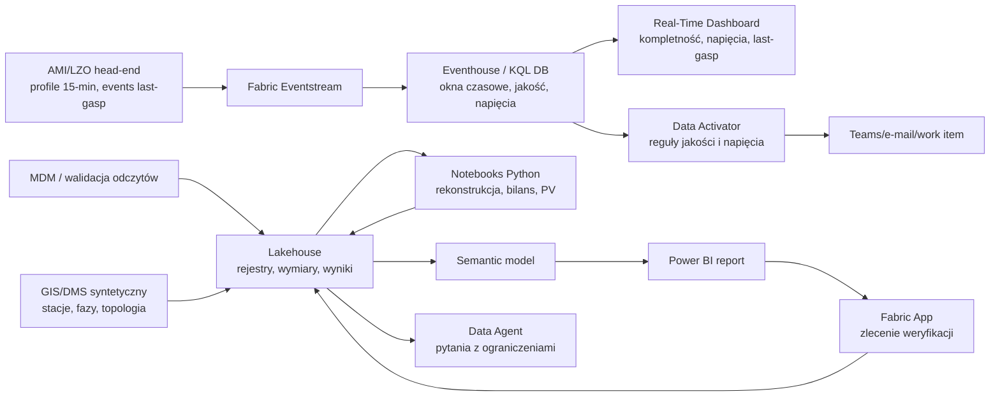

# Architektura rozwiązania

## Założenie operacyjne

Scenariusz rozdziela trzy cykle czasu. Przyjęcie danych AMI i alarmy `last_gasp` są sekundowe i trafiają przez Eventstream do Eventhouse. Rekonstrukcja przypisania liczników, bilans stacji i analiza wpływu PV są obliczeniami wsadowymi w notebookach. Warstwa decyzyjna korzysta z modelu semantycznego i raportu Power BI, a działania terenowe są domykane w Fabric App.

## Dlaczego Eventstream i Eventhouse są uzasadnione

W oknie demo powstaje 73 728 000 logicznych odczytów 15-min. Pytania dyżurnego są pytaniami o okno czasu: które stacje tracą kompletność, gdzie pojawiły się przekroczenia napięcia w ostatniej godzinie, czy alarmy `last_gasp` tworzą spójny obszar awarii. Eventhouse jest właściwy, bo KQL naturalnie obsługuje strumienie, agregacje po czasie i dashboard operacyjny. Eventstream oddziela przyjęcie danych od dalszej analityki i pozwala użyć tego samego kontraktu dla trybu live i replay.

## Dlaczego Lakehouse

Lakehouse przechowuje rejestry: `dim_meter`, `dim_station`, `dim_interval`, wyniki notebooków i ślad decyzji z Fabric App. To dane wersjonowane, wymagające lineage i powtarzalności. Rekonstrukcja stacja/faza i bilans strat są wynikami analitycznymi, nie kaflami dashboardu; powinny trafiać do Delta/Lakehouse i być odtwarzalne.

## Warstwa analityczna

Notatniki Python/Pandas/NumPy/scikit-learn wykonują:

1. Walidację jakości i kompletności.
2. Rekonstrukcję stacji/fazy z korelacji profili napięcia; wynik 96,54% na ukrytym zbiorze kontrolnym.
3. Bilans stacji: energia wprowadzona = suma liczników + straty techniczne + różnica bilansowa. Dla ST-019 różnica 410,0 kWh wymaga weryfikacji.
4. Detekcję przekroczeń napięcia i zdarzeń last-gasp.
5. Wpływ PV: w D0 średnie napięcie liczników PV w południe jest o 21,979 V wyższe niż bez PV.

## Diagram

## Granice odpowiedzialności

Eventstream przyjmuje zdarzenia. Eventhouse odpowiada na pytania operacyjne. Lakehouse przechowuje rejestry i wyniki. Notebooki liczą modele. Power BI tłumaczy wyniki decydentowi. Activator budzi człowieka. Fabric App zapisuje decyzję i zlecenie. Data Agent odpowiada tylko w granicach źródeł i nie formułuje oskarżeń.

## Co byłoby inaczej w prawdziwym wdrożeniu

- Integracja z AMI/MDM, GIS/DMS i systemami zleceń wymagałaby kontraktów danych, uprawnień i audytu.
- Dane 15-min profilu gospodarstwa domowego są danymi osobowymi; potrzebne są etykiety Purview, RLS, minimalizacja, retencja i audyt dostępu.
- Parametry strat technicznych i progi jakości wymagałyby kalibracji na rzeczywistych modelach sieci i procedurach OSD.
- Rekonstrukcja przypisania nie zastępuje ewidencji; wskazuje miejsca do potwierdzenia w GIS/DMS i w terenie.
