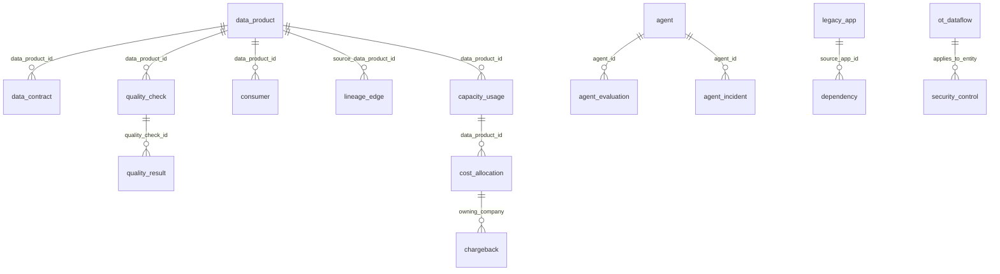

# Model danych

Wszystkie dane są syntetyczne, UTF-8, deterministyczne (`seed=42`). Nazwy techniczne są po angielsku bez polskich znaków. Tabele faktów zawierają obowiązkowe atrybuty czasu i jakości: `event_timestamp_utc`, `local_timezone`, `settlement_interval`, `source_system`, `quality_flag`, `ingestion_timestamp`, `data_version` tam, gdzie rekord opisuje zdarzenie lub pomiar.

## Encje i relacje

## `data_product.csv`

Produkt danych publikowany przez domenę. Ziarno: `data_product_id`. Kluczowe pola: `data_product_name`, `domain`, `owning_company`, `data_owner_role`, `technical_owner`, `business_criticality`, `classification`, `expected_freshness_h`, `consumer_count`, `status`. Własność domenowa oznacza, że platforma grupowa nie przejmuje odpowiedzialności merytorycznej za dane spółki.

## `data_contract.csv`

Kontrakt produktu danych. Ziarno: `contract_id`. Pola: `schema_version`, `freshness_sla_h`, `completeness_sla_pct`, `accuracy_sla_pct`, `owner_approved`, `consumer_approved`, `review_cycle`, `last_review_date`. Kontrakt bez właściciela lub konsumenta jest długiem operacyjnym.

## `quality_check.csv` i `quality_result.csv`

`quality_check` definiuje testy: freshness, completeness, accuracy, schema_compatibility. `quality_result` zawiera wyniki miesięczne przez 24 miesiące. Ziarno: `quality_result_id`. Pola faktu: `event_timestamp_utc`, `month`, `data_product_id`, `check_type`, `score_pct`, `passed` oraz atrybuty czasu i jakości z konwencji.

## `lineage_edge.csv`

Krawędź grafu lineage. Ziarno: `lineage_edge_id`. Pola: `source_data_product_id`, `target_data_product_id`, `edge_type`, `change_breaking_risk`. Graf musi być DAG; waliduje to `notebooks/02_lineage_blast_radius.py`.

## `consumer.csv`

Konsument produktu danych. Ziarno: `consumer_id`. Pola: `data_product_id`, `consumer_name`, `consumer_type`, `owning_company`, `access_purpose`, `last_access_date`. Notebook blast radius sprawdza, że wszyscy konsumenci wskazują istniejące produkty.

## `agent.csv`, `agent_evaluation.csv`, `agent_incident.csv`

Rejestr Agent Factory. `agent` zawiera właściciela, status cyklu życia, koszt kwartalny i źródła. `agent_evaluation` zawiera wynik groundedness, safety i decyzję. `agent_incident` zawiera zdarzenia z atrybutami czasu i jakości: severity, typ incydentu, status rozwiązania.

## `legacy_app.csv` i `dependency.csv`

Portfel legacy i zależności aplikacyjne. `legacy_app` ma: wiek, technologię, koszt utrzymania, ryzyko, krytyczność, zależność OT i rekomendację 6R. `dependency` opisuje zależności `database`, `file_export`, `api`, `manual_process`.

## `capacity_telemetry.jsonl`, `capacity_usage.csv`, `cost_allocation.csv`, `chargeback.csv`

Warstwa FinOps. `capacity_telemetry.jsonl` to godzinowy strumień użycia pojemności za 24 miesiące: 420 480 punktów dla 24 produktów danych. `capacity_usage` to miesięczny agregat pochodny używany w raporcie zarządczym. `cost_allocation` przypisuje koszt do produktu i spółki metodą `cu_hours_weighted`. `chargeback` agreguje koszt per spółka i miesiąc. `synthetic_cost_pln` nie jest cennikiem Microsoft ani kosztem Contoso Energia.

## `ot_dataflow.csv`

Przepływy strefy IT/OT. Pola: `source_zone`, `target_zone`, `direction`, `control_pattern`, `data_scope`, `approval_status`, `nis2_relevance`. Rekord `IT_to_OT` jest blokowany, żeby utrwalić zasadę: platforma analityczna nie steruje OT.

## `security_control.csv`

Kontrolki bezpieczeństwa i governance: etykiety Purview, RLS, zakaz sterowania OT, wymagany właściciel agenta, ewaluacja przed produkcją, chargeback approval workflow, impact review zmiany schematu i eskalacja NIS2.

## Wyniki pochodne

`datasets/derived/` zawiera wyniki notebooków: `quality_score.csv`, `quality_regressions.csv`, `lineage_blast_radius.csv`, `legacy_6r_scoring.csv`, `quarter_cost_by_product.csv`, `quarter_chargeback_by_company.csv`, `capacity_waste_candidates.csv`, `agent_portfolio_health.csv` oraz podsumowania JSON. Każda liczba w `DEMO_SCRIPT.md` pochodzi z tych plików.
